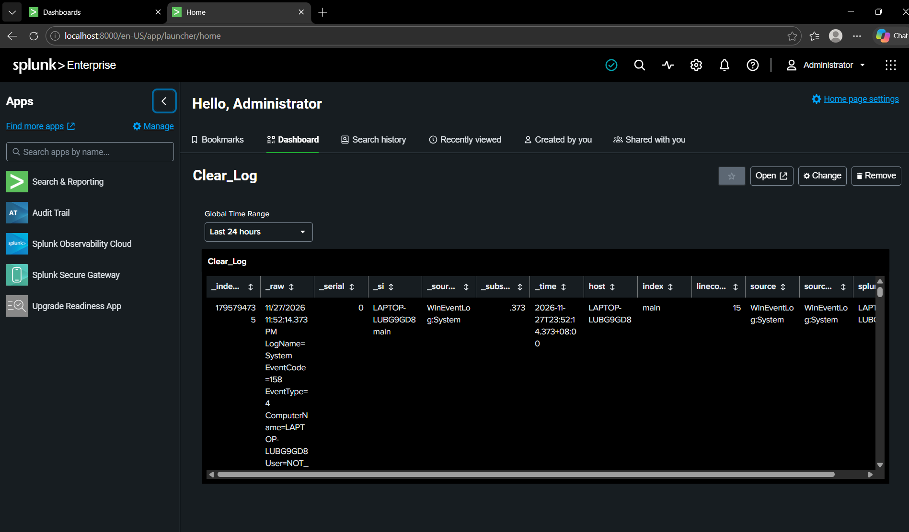

# 🖥️ Unified Host Security & System Diagnostics Monitoring (Splunk SIEM)

Name: Ahmad Faheem bin Sharifudin

A hands-on project demonstrating how to build a unified log monitoring pipeline using a local deployment of **Splunk Enterprise**. 

---

## 📌 Project Overview
The objective of this project was to turn my personal laptop into a monitored endpoint. By configuring Splunk Enterprise to ingest active local event logs, I built a centralized analytical pipeline to:
1. **Audit Security Events:** Track failed login attempts to identify potential unauthorized access.
2. **Diagnose Host System Errors:** Isolate OS and disk-level hardware warnings on my machine.

---

## 📊 Monitoring Dashboard


---

## 🛠️ Tech Stack & Skills
* **SIEM Platform:** Splunk Enterprise (Local Host)
* **Query Language:** Splunk SPL (Search Processing Language)
* **Data Sources:** Windows Event Logs (`WinEventLog:Security` and `WinEventLog:System`)

---

## 🔍 Core SPL Queries Used

1. Endpoint Security Auditing (Failed Logins)
*Monitors Windows Security Logs to identify unauthorized access patterns:*
```spl
source="WinEventLog:Security" EventCode=4625 
| stats count by user, src_ip 
| sort - count

2. Host System Diagnostics (Duplicate Disk GUID Troubleshooting)
Investigates Windows System Logs to isolate Event Code 158 while cleaning up default metadata fields:

 spl

 source="WinEventLog:System" host="LAPTOP-LUBG9GD8" EventCode=158
| fields - _bkt, _cd